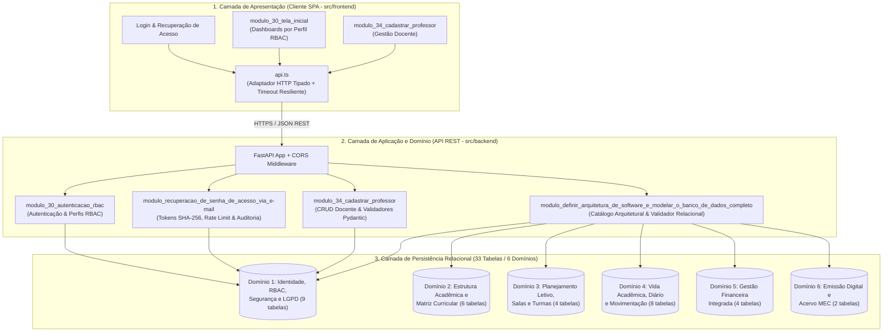

# Arquitetura de Software e Modelagem Completa do Banco de Dados — SGA-Edu (SGA-18)

**Sistema:** SGA-Edu (Sistema Integrado de Gestão Acadêmica do Ensino Superior)  
**Módulo:** `modulo_definir_arquitetura_de_software_e_modelar_o_banco_de_dados_completo`  
**Tarefa vinculada:** `SGA-18`  
**Status:** Implementado e Verificado

---

## 1. Visão Geral da Arquitetura Multicamadas

O **SGA-Edu** adota uma **Arquitetura Multicamadas Orientada a Módulos de Domínio**, isolando responsabilidades em três camadas independentes:

---

## 2. Matriz dos 6 Domínios e 33 Tabelas do Banco de Dados

| # | Domínio | Tabelas | Regras Chave de Integridade |
|---|---------|---------|-----------------------------|
| **1** | **Identidade, RBAC, Segurança e LGPD** | `Perfil`, `Usuario`, `Aluno`, `Professor`, `FuncionarioAdministrativo`, `TokenRecuperacao`, `LogAuditoriaRecuperacao`, `TermoConsentimentoLGPD`, `LogAuditoriaSistema` | 5 perfis RBAC fixos; `ON DELETE RESTRICT` em `Perfil`; `ON DELETE SET NULL` em `Professor` e logs de auditoria; `ON DELETE CASCADE` em `Aluno`, `FuncionarioAdministrativo`, `TokenRecuperacao` e `TermoConsentimentoLGPD`. |
| **2** | **Estrutura Acadêmica e Matriz Curricular** | `Departamento`, `Curso`, `MatrizCurricular`, `Disciplina`, `PreRequisito`, `EquivalenciaDisciplina` | `ON DELETE RESTRICT` impedindo remoção de departamentos, cursos, matrizes e disciplinas requisito em uso; `CHECK` impedindo auto-referência em pré-requisitos e equivalências. |
| **3** | **Planejamento Letivo, Salas e Turmas** | `PeriodoLetivo`, `Sala`, `Turma`, `HorarioTurma` | Unicidade de código de período, sala e turma; `CHECK (dia_semana >= 1 AND dia_semana <= 7)` e unicidade de horário por turma. |
| **4** | **Vida Acadêmica, Diário de Classe e Movimentação** | `MatriculaTurma`, `AvaliacaoNota`, `RegistroFrequencia`, `PlanoEnsino`, `MaterialAula`, `ComunicadoTurma`, `MovimentacaoAcademica`, `RequerimentoAcademico` | Unicidade de matrícula `(aluno_matricula, turma_id)`; `CHECK (nota >= 0.00 AND nota <= 10.00)` em `AvaliacaoNota`; protocolo único em `RequerimentoAcademico`. |
| **5** | **Gestão Financeira Integrada** | `ContratoFinanceiro`, `BolsaDesconto`, `CobrancaMensalidade`, `PagamentoConciliacao` | Unicidade de contrato por `(aluno_matricula, periodo_letivo_id)`; `CHECK (percentual_desconto >= 0.00 AND percentual_desconto <= 100.00)` em `BolsaDesconto`; bloqueio de exclusão de contratos/cobranças com pagamentos. |
| **6** | **Emissão Digital e Acervo Regulatório MEC** | `DocumentoAcademico`, `AcervoDigitalMEC` | Unicidade de `codigo_verificacao` para validação por QR Code; vínculo 1:1 com `AcervoDigitalMEC` sob Portarias MEC nº 315/2018 e nº 360/2022. |

---

## 3. Decisões Arquiteturais (ADRs do Módulo)

### ADR-BD-001: Preservação Retroativa e Consolidação dos 6 Domínios
- **Contexto:** Os módulos iniciais modelaram `Perfil`, `Usuario`, `Aluno`, `Professor`, `FuncionarioAdministrativo`, `TokenRecuperacao` e `LogAuditoriaRecuperacao`. O backlog (`SGA-18`) requer a definição da arquitetura completa e a modelagem integral de todos os domínios previstos no `PRD.md` e `PLAN.md`.
- **Decisão:** Manter 100% da assinatura das 7 tabelas existentes e expandir o esquema para 33 tabelas relacionais em `schema_completo_ddl.sql`.
- **Consequências:** Nenhuma quebra nos módulos já existentes e cobertura total para os módulos de secretaria, matriz curricular, matrícula online, diário de classe, financeiro e acervo MEC.

### ADR-BD-002: Políticas de Deleção Diferenciadas para Conformidade Regulatória (MEC e LGPD)
- **Contexto:** A exclusão de uma conta de acesso (`Usuario`) não pode apagar o histórico funcional de docentes nem destruir trilhas de auditoria de segurança.
- **Decisão:** Configurar `ON DELETE SET NULL` nas chaves estrangeiras para `Usuario` em `Professor`, `LogAuditoriaRecuperacao` e `LogAuditoriaSistema`, e `ON DELETE RESTRICT` nas entidades estruturais (`Perfil`, `Departamento`, `Curso`, `MatrizCurricular`, `Disciplina`, `PeriodoLetivo`, `Turma`, `MatriculaTurma`, `ContratoFinanceiro`, `CobrancaMensalidade`, `DocumentoAcademico`).
- **Consequências:** Preservação garantida do acervo acadêmico e das trilhas de auditoria diretamente pelo SGBD.
